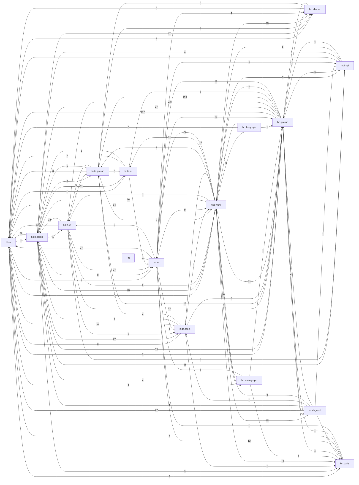

# Hide — carte des dépendances

> Généré par `tools/docgen/deps.py` (analyse statique, sans compilateur Haxe). Ne pas éditer à la main.

- Modules (fichiers `.hx`) : **616** — lignes : **163158** — packages : **39**
- Dépendances module→module : **2787**
- Cycles de modules (SCC > 1) : **9**

Légende des types d'arêtes : `import`, `using`, `extends`, `implements`, `use` (référence dans le code).

## Packages

| Package | Modules | Lignes | Blocs doc `/** */` | Dépend de (packages) | Utilisé par |
|---|---:|---:|---:|---|---|
| [`hide`](modules/hide.md) | 11 | 2516 | 82 | hide.comp, hide.tools, hide.ui, hide.view, hrt.prefab, hrt.prefab.fx, hrt.shader, hrt.tools, hrt.ui | 34 |
| [`hide.comp`](modules/hide.comp.md) | 46 | 23052 | 919 | hide, hide.comp.cdb, hide.kit, hide.prefab, hide.tools, hide.ui, hide.view, hide.view.l3d, hrt.impl, hrt.prefab, hrt.prefab.fx, hrt.prefab.l3d, hrt.prefab.rfx, hrt.shader, hrt.tools, hrt.ui | 21 |
| [`hide.comp.cdb`](modules/hide.comp.cdb.md) | 12 | 10163 | 290 | hide, hide.comp, hide.tools, hide.ui, hide.view, hrt.prefab, hrt.tools, hrt.ui | 6 |
| [`hide.kit`](modules/hide.kit.md) | 30 | 4900 | 187 | hide, hide.comp, hide.comp.cdb, hide.prefab, hide.tools, hide.view, hrt.impl, hrt.prefab, hrt.ui | 7 |
| [`hide.prefab`](modules/hide.prefab.md) | 4 | 1582 | 73 | hide, hide.comp, hide.ui, hide.view, hrt.prefab, hrt.prefab.l3d, hrt.prefab.rfx | 17 |
| [`hide.prefab.propsEditor`](modules/hide.prefab.propsEditor.md) | 4 | 185 | 7 | hide, hide.kit, hrt.prefab | 1 |
| [`hide.prefab.terrain`](modules/hide.prefab.terrain.md) | 11 | 2012 | 105 | hide, hide.prefab, hide.ui, hrt.prefab.terrain, hrt.shader | 1 |
| [`hide.tools`](modules/hide.tools.md) | 14 | 4464 | 229 | hide, hide.comp, hide.comp.cdb, hide.prefab, hide.view, hrt.prefab, hrt.prefab.fx, hrt.tools | 9 |
| [`hide.ui`](modules/hide.ui.md) | 5 | 903 | 80 | hide, hide.comp, hrt.ui | 11 |
| [`hide.view`](modules/hide.view.md) | 30 | 16597 | 319 | hide, hide.comp, hide.comp.cdb, hide.kit, hide.prefab, hide.tools, hide.ui, hide.view.l3d, hide.view.shadereditor, hrt.impl, hrt.prefab, hrt.prefab.fx, hrt.prefab.l2d, hrt.prefab.l3d, hrt.prefab.rfx, hrt.shader, hrt.shgraph, hrt.tools, hrt.ui | 20 |
| [`hide.view.animgraph`](modules/hide.view.animgraph.md) | 4 | 1508 | 25 | hide, hide.comp, hide.tools, hide.ui, hide.view, hrt.animgraph, hrt.animgraph.nodes, hrt.prefab, hrt.ui | 2 |
| [`hide.view.l3d`](modules/hide.view.l3d.md) | 4 | 924 | 40 | hide.comp, hrt.prefab, hrt.prefab.vlm, hrt.shader | 4 |
| [`hide.view.settings`](modules/hide.view.settings.md) | 3 | 669 | 25 | hide, hide.comp, hide.ui, hide.view | 0 |
| [`hide.view.shadereditor`](modules/hide.view.shadereditor.md) | 2 | 2937 | 106 | hide, hide.comp, hide.prefab, hide.tools, hide.ui, hide.view, hrt.prefab, hrt.prefab.fx, hrt.prefab.l3d, hrt.prefab.rfx, hrt.shgraph, hrt.shgraph.nodes, hrt.ui | 4 |
| [`hide.view.textureeditor`](modules/hide.view.textureeditor.md) | 1 | 532 | 23 | hide, hide.comp, hide.ui, hide.view, hide.view.l3d, hrt.texgraph, hrt.texgraph.nodes | 1 |
| [`hrt`](modules/hrt.md) | 1 | 5 | 0 | hrt.ui | 0 |
| [`hrt.animgraph`](modules/hrt.animgraph.md) | 8 | 1381 | 87 | hide, hide.view, hide.view.animgraph, hrt.animgraph.nodes, hrt.prefab, hrt.tools | 2 |
| [`hrt.animgraph.nodes`](modules/hrt.animgraph.nodes.md) | 8 | 665 | 32 | hide, hide.comp, hide.view, hide.view.animgraph, hrt.animgraph, hrt.tools, hrt.ui | 2 |
| [`hrt.impl`](modules/hrt.impl.md) | 8 | 2484 | 145 | hide, hide.comp, hide.view, hrt.prefab, hrt.prefab.l3d | 10 |
| [`hrt.prefab`](modules/hrt.prefab.md) | 25 | 10857 | 501 | hide, hide.comp, hide.comp.cdb, hide.kit, hide.prefab, hide.prefab.propsEditor, hide.view, hide.view.shadereditor, hrt.impl, hrt.prefab.editor, hrt.prefab.fx, hrt.prefab.l2d, hrt.prefab.l3d, hrt.prefab.rfx, hrt.shgraph, hrt.tools, hrt.ui | 29 |
| [`hrt.prefab.editor`](modules/hrt.prefab.editor.md) | 3 | 198 | 15 | hrt.prefab | 2 |
| [`hrt.prefab.fx`](modules/hrt.prefab.fx.md) | 16 | 9826 | 682 | hide, hide.comp, hide.kit, hide.prefab, hrt.impl, hrt.prefab, hrt.prefab.fx.gpuemitter, hrt.prefab.l2d, hrt.prefab.l3d, hrt.prefab.rfx, hrt.shader, hrt.tools, hrt.ui | 11 |
| [`hrt.prefab.fx.gpuemitter`](modules/hrt.prefab.fx.gpuemitter.md) | 20 | 2313 | 73 | hide, hide.prefab, hrt.prefab, hrt.prefab.fx | 1 |
| [`hrt.prefab.l2d`](modules/hrt.prefab.l2d.md) | 10 | 1919 | 65 | hide, hide.comp, hide.prefab, hide.view, hrt.impl, hrt.prefab, hrt.prefab.fx | 4 |
| [`hrt.prefab.l3d`](modules/hrt.prefab.l3d.md) | 26 | 15592 | 455 | hide, hide.comp, hide.comp.cdb, hide.kit, hide.prefab, hide.ui, hrt.impl, hrt.prefab, hrt.prefab.editor, hrt.prefab.fx, hrt.prefab.rfx, hrt.shader, hrt.ui | 7 |
| [`hrt.prefab.l3d.modellibrary`](modules/hrt.prefab.l3d.modellibrary.md) | 7 | 1829 | 74 | hide, hide.prefab, hrt.prefab, hrt.prefab.fx | 0 |
| [`hrt.prefab.pbr`](modules/hrt.prefab.pbr.md) | 3 | 718 | 35 | hide, hide.prefab, hrt.prefab, hrt.shader | 1 |
| [`hrt.prefab.rfx`](modules/hrt.prefab.rfx.md) | 25 | 6274 | 286 | hide, hide.comp, hide.prefab, hrt.impl, hrt.prefab, hrt.prefab.l2d, hrt.prefab.pbr, hrt.shader, hrt.shgraph, hrt.ui | 8 |
| [`hrt.prefab.terrain`](modules/hrt.prefab.terrain.md) | 7 | 2145 | 133 | hide, hide.prefab, hide.prefab.terrain, hrt.prefab, hrt.shader | 1 |
| [`hrt.prefab.vlm`](modules/hrt.prefab.vlm.md) | 5 | 1898 | 74 | hide, hide.prefab, hide.view.l3d, hrt.prefab, hrt.shader | 1 |
| [`hrt.shader`](modules/hrt.shader.md) | 33 | 2372 | 66 | hide, hide.prefab, hrt.prefab | 12 |
| [`hrt.shgraph`](modules/hrt.shgraph.md) | 24 | 4861 | 334 | hide, hide.comp, hide.tools, hide.view, hide.view.shadereditor, hrt.impl, hrt.prefab, hrt.shgraph.nodes, hrt.tools | 5 |
| [`hrt.shgraph.nodes`](modules/hrt.shgraph.nodes.md) | 110 | 4013 | 137 | hide, hide.comp, hide.view, hide.view.shadereditor, hrt.shgraph | 2 |
| [`hrt.texgraph`](modules/hrt.texgraph.md) | 3 | 700 | 61 | hide, hide.view, hrt.prefab, hrt.texgraph.nodes | 2 |
| [`hrt.texgraph.nodes`](modules/hrt.texgraph.nodes.md) | 9 | 531 | 19 | hide, hide.view, hide.view.textureeditor, hrt.texgraph | 2 |
| [`hrt.tools`](modules/hrt.tools.md) | 14 | 3383 | 145 | hide, hrt.prefab, hrt.ui | 11 |
| [`hrt.ui`](modules/hrt.ui.md) | 66 | 15389 | 115 | hide, hide.kit, hide.tools, hide.view, hrt.impl, hrt.prefab, hrt.prefab.fx, hrt.prefab.rfx, hrt.shader, hrt.tools, hrt.ui.hide, hrt.ui.tests | 17 |
| [`hrt.ui.hide`](modules/hrt.ui.hide.md) | 2 | 30 | 0 | hide, hrt.ui | 1 |
| [`hrt.ui.tests`](modules/hrt.ui.tests.md) | 2 | 831 | 0 | hrt.prefab, hrt.ui | 1 |

## Graphe des packages (niveau 2)

## Cycles entre packages

- hide ⇄ hide.comp ⇄ hide.kit ⇄ hide.prefab ⇄ hide.tools ⇄ hide.ui ⇄ hide.view ⇄ hrt.animgraph ⇄ hrt.impl ⇄ hrt.prefab ⇄ hrt.shader ⇄ hrt.shgraph ⇄ hrt.texgraph ⇄ hrt.tools ⇄ hrt.ui

## Ordre de documentation suggéré

Ordre topologique (les dépendances d'abord). Les modules entre crochets forment un cycle et doivent être documentés ensemble.

1. [`hrt.tools.Macros`](modules/hrt.tools.md#hrttoolsmacros)
2. [`hrt.ui.HuiRes`](modules/hrt.ui.md#hrtuihuires)
3. [`hrt.ui.CssParser`](modules/hrt.ui.md#hrtuicssparser)
4. [`hrt.ui.HuiBackground`](modules/hrt.ui.md#hrtuihuibackground)
5. [`hrt.ui.HuiCommands`](modules/hrt.ui.md#hrtuihuicommands)
6. [`hide.tools.Profiler`](modules/hide.tools.md#hidetoolsprofiler)
7. [`hide.Search`](modules/hide.md#hidesearch)
8. [`hide.Element`](modules/hide.md#hideelement)
9. [`hide.ui.UndoHistory`](modules/hide.ui.md#hideuiundohistory)
10. [`hide.comp.JsTools`](modules/hide.comp.md#hidecompjstools)
11. [`hrt.impl.ColorSpace`](modules/hrt.impl.md#hrtimplcolorspace)
12. [`hide.comp.ResizeObserver`](modules/hide.comp.md#hidecompresizeobserver)
13. [`hide.tools.Delayer`](modules/hide.tools.md#hidetoolsdelayer)
14. [`hrt.prefab.Cache`](modules/hrt.prefab.md#hrtprefabcache)
15. [`hide.tools.Extensions`](modules/hide.tools.md#hidetoolsextensions)
16. [`hrt.impl.Gradient`](modules/hrt.impl.md#hrtimplgradient)
17. [`hrt.impl.TextureType`](modules/hrt.impl.md#hrtimpltexturetype)
18. [`hide.kit.KitColor`](modules/hide.kit.md#hidekitkitcolor)
19. [`hrt.tools.MapUtils`](modules/hrt.tools.md#hrttoolsmaputils)
20. [`hrt.prefab.Diff`](modules/hrt.prefab.md#hrtprefabdiff)
21. [`hrt.shader.PreviewShaderAlpha`](modules/hrt.shader.md#hrtshaderpreviewshaderalpha)
22. [`hide.ui.QueryHelper`](modules/hide.ui.md#hideuiqueryhelper)
23. [`hrt.tools.CdbUtils`](modules/hrt.tools.md#hrttoolscdbutils)
24. [`hrt.prefab.editor.Props`](modules/hrt.prefab.editor.md#hrtprefabeditorprops)
25. [`hrt.tools.Undo`](modules/hrt.tools.md#hrttoolsundo)
26. [`hrt.tools.Gizmo`](modules/hrt.tools.md#hrttoolsgizmo)
27. [`hrt.shader.SDF`](modules/hrt.shader.md#hrtshadersdf)
28. [`hrt.tools.Grid`](modules/hrt.tools.md#hrttoolsgrid)
29. [`hrt.tools.ViewportAxis`](modules/hrt.tools.md#hrttoolsviewportaxis)
30. [`hrt.shader.DissolveBurn`](modules/hrt.shader.md#hrtshaderdissolveburn)
31. [`hrt.shader.EmissiveMult`](modules/hrt.shader.md#hrtshaderemissivemult)
32. [`hrt.shader.GradientFlat`](modules/hrt.shader.md#hrtshadergradientflat)
33. [`hrt.shader.GradientMap`](modules/hrt.shader.md#hrtshadergradientmap)
34. [`hrt.shader.BaseEmitter`](modules/hrt.shader.md#hrtshaderbaseemitter)
35. [`hrt.shader.GradientMapLife`](modules/hrt.shader.md#hrtshadergradientmaplife)
36. [`hrt.shader.HeightGradient`](modules/hrt.shader.md#hrtshaderheightgradient)
37. [`hrt.shader.MaskColorAlpha`](modules/hrt.shader.md#hrtshadermaskcoloralpha)
38. [`hrt.shader.MeshWave`](modules/hrt.shader.md#hrtshadermeshwave)
39. [`hrt.shader.ParticleColorLife`](modules/hrt.shader.md#hrtshaderparticlecolorlife)
40. [`hrt.shader.ParticleColorRandom`](modules/hrt.shader.md#hrtshaderparticlecolorrandom)
41. [`hrt.shader.ParticleFade`](modules/hrt.shader.md#hrtshaderparticlefade)
42. [`hrt.shader.ParticleRandomMesh`](modules/hrt.shader.md#hrtshaderparticlerandommesh)
43. [`hrt.shader.Spinner`](modules/hrt.shader.md#hrtshaderspinner)
44. [`hrt.shader.TextureMult`](modules/hrt.shader.md#hrtshadertexturemult)
45. [`hrt.shader.TextureRotate`](modules/hrt.shader.md#hrtshadertexturerotate)
46. [`hrt.shader.UVDebug`](modules/hrt.shader.md#hrtshaderuvdebug)
47. [`hrt.tools.ClassUtils`](modules/hrt.tools.md#hrttoolsclassutils)
48. [`hrt.shgraph.AstTools`](modules/hrt.shgraph.md#hrtshgraphasttools)
49. [`hrt.shgraph.SgHxslVar`](modules/hrt.shgraph.md#hrtshgraphsghxslvar)
50. [`hrt.shgraph.Utils`](modules/hrt.shgraph.md#hrtshgraphutils)
51. [`hrt.shgraph.Variables`](modules/hrt.shgraph.md#hrtshgraphvariables)
52. [`hrt.shgraph.ShaderType`](modules/hrt.shgraph.md#hrtshgraphshadertype)
53. [`hrt.tools.OneToMany`](modules/hrt.tools.md#hrttoolsonetomany)
54. [`hrt.prefab.Props`](modules/hrt.prefab.md#hrtprefabprops)
55. [`hrt.shgraph.ShaderException`](modules/hrt.shgraph.md#hrtshgraphshaderexception)
56. [`hide.kit.Macros`](modules/hide.kit.md#hidekitmacros)
57. [`hrt.prefab.fx.gpuemitter.PreviousModelViewSimulation`](modules/hrt.prefab.fx.gpuemitter.md#hrtprefabfxgpuemitterpreviousmodelviewsimulation)
58. [`hrt.prefab.fx.gpuemitter.UpdateParamShader`](modules/hrt.prefab.fx.gpuemitter.md#hrtprefabfxgpuemitterupdateparamshader)
59. [`hrt.shader.BaseTrails`](modules/hrt.shader.md#hrtshaderbasetrails)
60. [`hrt.tools.GraphicsTools`](modules/hrt.tools.md#hrttoolsgraphicstools)
61. [`hrt.tools.Delayer`](modules/hrt.tools.md#hrttoolsdelayer)
62. [`hrt.tools.ProcessAsync`](modules/hrt.tools.md#hrttoolsprocessasync)
63. [`hide.view.l3d.CameraController2D`](modules/hide.view.l3d.md#hideviewl3dcameracontroller2d)
64. [`hrt.impl.BuildTools`](modules/hrt.impl.md#hrtimplbuildtools)
65. [`hide.comp.RadialMenu`](modules/hide.comp.md#hidecompradialmenu)
66. [`hide.view.l3d.Gizmo2D`](modules/hide.view.l3d.md#hideviewl3dgizmo2d)
67. [`hrt.ui.tests.Macros`](modules/hrt.ui.tests.md#hrtuitestsmacros)
68. [`hide.tools.AutoProfiler`](modules/hide.tools.md#hidetoolsautoprofiler)
69. [[`hide.App`](modules/hide.md#hideapp), [`hide.Config`](modules/hide.md#hideconfig), [`hide.Extension`](modules/hide.md#hideextension), [`hide.HideProjectConfig`](modules/hide.md#hidehideprojectconfig), [`hide.Ide`](modules/hide.md#hideide), [`hide.Renderer`](modules/hide.md#hiderenderer), [`hide.ThumbnailGeneratorApp`](modules/hide.md#hidethumbnailgeneratorapp), [`hide.comp.Button`](modules/hide.comp.md#hidecompbutton), [`hide.comp.CameraControllerEditor`](modules/hide.comp.md#hidecompcameracontrollereditor), [`hide.comp.CodeEditor`](modules/hide.comp.md#hidecompcodeeditor), [`hide.comp.ColorPicker`](modules/hide.comp.md#hidecompcolorpicker), [`hide.comp.Component`](modules/hide.comp.md#hidecompcomponent), [`hide.comp.ContentEditable`](modules/hide.comp.md#hidecompcontenteditable), [`hide.comp.ContextMenu`](modules/hide.comp.md#hidecompcontextmenu), [`hide.comp.CurveEditor`](modules/hide.comp.md#hidecompcurveeditor), [`hide.comp.DetachablePanel`](modules/hide.comp.md#hidecompdetachablepanel), [`hide.comp.DomkitEditor`](modules/hide.comp.md#hidecompdomkiteditor), [`hide.comp.Dropdown`](modules/hide.comp.md#hidecompdropdown), [`hide.comp.ExpRange`](modules/hide.comp.md#hidecompexprange), [`hide.comp.FancyArray`](modules/hide.comp.md#hidecompfancyarray), [`hide.comp.FancyClosable`](modules/hide.comp.md#hidecompfancyclosable), [`hide.comp.FancySearch`](modules/hide.comp.md#hidecompfancysearch), [`hide.comp.FancyTooltip`](modules/hide.comp.md#hidecompfancytooltip), [`hide.comp.FancyTree`](modules/hide.comp.md#hidecompfancytree), [`hide.comp.FileSelect`](modules/hide.comp.md#hidecompfileselect), [`hide.comp.FileSelect2`](modules/hide.comp.md#hidecompfileselect2), [`hide.comp.GlobalSeek`](modules/hide.comp.md#hidecompglobalseek), [`hide.comp.GradientEditor`](modules/hide.comp.md#hidecompgradienteditor), [`hide.comp.Modal`](modules/hide.comp.md#hidecompmodal), [`hide.comp.MultiRange`](modules/hide.comp.md#hidecompmultirange), [`hide.comp.Popup`](modules/hide.comp.md#hidecomppopup), [`hide.comp.PropsEditor`](modules/hide.comp.md#hidecomppropseditor), [`hide.comp.Range`](modules/hide.comp.md#hidecomprange), [`hide.comp.ResizablePanel`](modules/hide.comp.md#hidecompresizablepanel), [`hide.comp.SVG`](modules/hide.comp.md#hidecompsvg), [`hide.comp.Scene`](modules/hide.comp.md#hidecompscene), [`hide.comp.SceneEditor`](modules/hide.comp.md#hidecompsceneeditor), [`hide.comp.ScenePreview`](modules/hide.comp.md#hidecompscenepreview), [`hide.comp.ScriptEditor`](modules/hide.comp.md#hidecompscripteditor), [`hide.comp.Select`](modules/hide.comp.md#hidecompselect), [`hide.comp.Tabs`](modules/hide.comp.md#hidecomptabs), [`hide.comp.TextureChoice`](modules/hide.comp.md#hidecomptexturechoice), [`hide.comp.TextureChoice2`](modules/hide.comp.md#hidecomptexturechoice2), [`hide.comp.TextureSelect`](modules/hide.comp.md#hidecomptextureselect), [`hide.comp.TextureSelect2`](modules/hide.comp.md#hidecomptextureselect2), [`hide.comp.Toolbar`](modules/hide.comp.md#hidecomptoolbar), [`hide.comp.cdb.Cell`](modules/hide.comp.cdb.md#hidecompcdbcell), [`hide.comp.cdb.Cursor`](modules/hide.comp.cdb.md#hidecompcdbcursor), [`hide.comp.cdb.DataFiles`](modules/hide.comp.cdb.md#hidecompcdbdatafiles), [`hide.comp.cdb.Editor`](modules/hide.comp.cdb.md#hidecompcdbeditor), [`hide.comp.cdb.Formulas`](modules/hide.comp.cdb.md#hidecompcdbformulas), [`hide.comp.cdb.Line`](modules/hide.comp.cdb.md#hidecompcdbline), [`hide.comp.cdb.ModalColumnForm`](modules/hide.comp.cdb.md#hidecompcdbmodalcolumnform), [`hide.comp.cdb.ObjEditor`](modules/hide.comp.cdb.md#hidecompcdbobjeditor), [`hide.comp.cdb.ScriptTable`](modules/hide.comp.cdb.md#hidecompcdbscripttable), [`hide.comp.cdb.Separator`](modules/hide.comp.cdb.md#hidecompcdbseparator), [`hide.comp.cdb.SubTable`](modules/hide.comp.cdb.md#hidecompcdbsubtable), [`hide.comp.cdb.Table`](modules/hide.comp.cdb.md#hidecompcdbtable), [`hide.kit.Block`](modules/hide.kit.md#hidekitblock), [`hide.kit.Button`](modules/hide.kit.md#hidekitbutton), [`hide.kit.CDB`](modules/hide.kit.md#hidekitcdb), [`hide.kit.Category`](modules/hide.kit.md#hidekitcategory), [`hide.kit.Checkbox`](modules/hide.kit.md#hidekitcheckbox), [`hide.kit.Color`](modules/hide.kit.md#hidekitcolor), [`hide.kit.Element`](modules/hide.kit.md#hidekitelement), [`hide.kit.File`](modules/hide.kit.md#hidekitfile), [`hide.kit.Gradient`](modules/hide.kit.md#hidekitgradient), [`hide.kit.Input`](modules/hide.kit.md#hidekitinput), [`hide.kit.KitRoot`](modules/hide.kit.md#hidekitkitroot), [`hide.kit.Line`](modules/hide.kit.md#hidekitline), [`hide.kit.List`](modules/hide.kit.md#hidekitlist), [`hide.kit.NativeElement`](modules/hide.kit.md#hidekitnativeelement), [`hide.kit.Select`](modules/hide.kit.md#hidekitselect), [`hide.kit.Slider`](modules/hide.kit.md#hidekitslider), [`hide.kit.SliderGroup`](modules/hide.kit.md#hidekitslidergroup), [`hide.kit.Text`](modules/hide.kit.md#hidekittext), [`hide.kit.Texture`](modules/hide.kit.md#hidekittexture), [`hide.kit.Widget`](modules/hide.kit.md#hidekitwidget), [`hide.prefab.ContextShared`](modules/hide.prefab.md#hideprefabcontextshared), [`hide.prefab.EditContext`](modules/hide.prefab.md#hideprefabeditcontext), [`hide.prefab.HideProps`](modules/hide.prefab.md#hideprefabhideprops), [`hide.prefab.PolygonEditor`](modules/hide.prefab.md#hideprefabpolygoneditor), [`hide.prefab.propsEditor.AnyPropsEditor`](modules/hide.prefab.propsEditor.md#hideprefabpropseditoranypropseditor), [`hide.tools.DragAndDrop`](modules/hide.tools.md#hidetoolsdraganddrop), [`hide.tools.FileManager`](modules/hide.tools.md#hidetoolsfilemanager), [`hide.tools.FileWatcher`](modules/hide.tools.md#hidetoolsfilewatcher), [`hide.tools.GameLauncher`](modules/hide.tools.md#hidetoolsgamelauncher), [`hide.tools.IdeData`](modules/hide.tools.md#hidetoolsidedata), [`hide.tools.ShaderLoader`](modules/hide.tools.md#hidetoolsshaderloader), [`hide.tools.ThumbnailGenerator`](modules/hide.tools.md#hidetoolsthumbnailgenerator), [`hide.ui.Keys`](modules/hide.ui.md#hideuikeys), [`hide.ui.View`](modules/hide.ui.md#hideuiview), [`hide.view.CameraController`](modules/hide.view.md#hideviewcameracontroller), [`hide.view.CdbFavorites`](modules/hide.view.md#hideviewcdbfavorites), [`hide.view.CdbTable`](modules/hide.view.md#hideviewcdbtable), [`hide.view.DomkitStudio`](modules/hide.view.md#hideviewdomkitstudio), [`hide.view.FXEditor`](modules/hide.view.md#hideviewfxeditor), [`hide.view.FileBrowser`](modules/hide.view.md#hideviewfilebrowser), [`hide.view.FileView`](modules/hide.view.md#hideviewfileview), [`hide.view.GraphEditor`](modules/hide.view.md#hideviewgrapheditor), [`hide.view.GraphInterface`](modules/hide.view.md#hideviewgraphinterface), [`hide.view.MemProfiler`](modules/hide.view.md#hideviewmemprofiler), [`hide.view.Model`](modules/hide.view.md#hideviewmodel), [`hide.view.Particles2D`](modules/hide.view.md#hideviewparticles2d), [`hide.view.Prefab`](modules/hide.view.md#hideviewprefab), [`hide.view.PrefabUndo`](modules/hide.view.md#hideviewprefabundo), [`hide.view.RefViewer`](modules/hide.view.md#hideviewrefviewer), [`hide.view.RemoteConsoleView`](modules/hide.view.md#hideviewremoteconsoleview), [`hide.view.Script`](modules/hide.view.md#hideviewscript), [`hide.view.Texture`](modules/hide.view.md#hideviewtexture), [`hide.view.Timeline`](modules/hide.view.md#hideviewtimeline), [`hide.view.shadereditor.Box`](modules/hide.view.shadereditor.md#hideviewshadereditorbox), [`hide.view.shadereditor.ShaderEditor`](modules/hide.view.shadereditor.md#hideviewshadereditorshadereditor), [`hrt.impl.EditorTools`](modules/hrt.impl.md#hrtimpleditortools), [`hrt.impl.RemoteConsole`](modules/hrt.impl.md#hrtimplremoteconsole), [`hrt.impl.RemoteTools`](modules/hrt.impl.md#hrtimplremotetools), [`hrt.prefab.ContextShared`](modules/hrt.prefab.md#hrtprefabcontextshared), [`hrt.prefab.Curve`](modules/hrt.prefab.md#hrtprefabcurve), [`hrt.prefab.DynamicShader`](modules/hrt.prefab.md#hrtprefabdynamicshader), [`hrt.prefab.EditContext2`](modules/hrt.prefab.md#hrtprefabeditcontext2), [`hrt.prefab.Light`](modules/hrt.prefab.md#hrtprefablight), [`hrt.prefab.Macros`](modules/hrt.prefab.md#hrtprefabmacros), [`hrt.prefab.Material`](modules/hrt.prefab.md#hrtprefabmaterial), [`hrt.prefab.MaterialLibrary`](modules/hrt.prefab.md#hrtprefabmateriallibrary), [`hrt.prefab.MaterialSelector`](modules/hrt.prefab.md#hrtprefabmaterialselector), [`hrt.prefab.Model`](modules/hrt.prefab.md#hrtprefabmodel), [`hrt.prefab.Object2D`](modules/hrt.prefab.md#hrtprefabobject2d), [`hrt.prefab.Object3D`](modules/hrt.prefab.md#hrtprefabobject3d), [`hrt.prefab.Prefab`](modules/hrt.prefab.md#hrtprefabprefab), [`hrt.prefab.Reference`](modules/hrt.prefab.md#hrtprefabreference), [`hrt.prefab.RenderProfile`](modules/hrt.prefab.md#hrtprefabrenderprofile), [`hrt.prefab.RenderProps`](modules/hrt.prefab.md#hrtprefabrenderprops), [`hrt.prefab.SceneEditorAPI`](modules/hrt.prefab.md#hrtprefabsceneeditorapi), [`hrt.prefab.Shader`](modules/hrt.prefab.md#hrtprefabshader), [`hrt.prefab.Unknown`](modules/hrt.prefab.md#hrtprefabunknown), [`hrt.prefab.editor.QuickTool`](modules/hrt.prefab.editor.md#hrtprefabeditorquicktool), [`hrt.prefab.editor.Tool`](modules/hrt.prefab.editor.md#hrtprefabeditortool), [`hrt.prefab.fx.AnimEvent`](modules/hrt.prefab.fx.md#hrtprefabfxanimevent), [`hrt.prefab.fx.BaseFX`](modules/hrt.prefab.fx.md#hrtprefabfxbasefx), [`hrt.prefab.fx.Emitter`](modules/hrt.prefab.fx.md#hrtprefabfxemitter), [`hrt.prefab.fx.Emitter2D`](modules/hrt.prefab.fx.md#hrtprefabfxemitter2d), [`hrt.prefab.fx.EmitterHelper`](modules/hrt.prefab.fx.md#hrtprefabfxemitterhelper), [`hrt.prefab.fx.EmitterMacros`](modules/hrt.prefab.fx.md#hrtprefabfxemittermacros), [`hrt.prefab.fx.Evaluator`](modules/hrt.prefab.fx.md#hrtprefabfxevaluator), [`hrt.prefab.fx.Event`](modules/hrt.prefab.fx.md#hrtprefabfxevent), [`hrt.prefab.fx.FX`](modules/hrt.prefab.fx.md#hrtprefabfxfx), [`hrt.prefab.fx.FX2D`](modules/hrt.prefab.fx.md#hrtprefabfxfx2d), [`hrt.prefab.fx.ShaderTarget`](modules/hrt.prefab.fx.md#hrtprefabfxshadertarget), [`hrt.prefab.fx.SubFX`](modules/hrt.prefab.fx.md#hrtprefabfxsubfx), [`hrt.prefab.fx.Value`](modules/hrt.prefab.fx.md#hrtprefabfxvalue), [`hrt.prefab.fx.gpuemitter.BaseSimulation`](modules/hrt.prefab.fx.gpuemitter.md#hrtprefabfxgpuemitterbasesimulation), [`hrt.prefab.fx.gpuemitter.BaseSpawn`](modules/hrt.prefab.fx.gpuemitter.md#hrtprefabfxgpuemitterbasespawn), [`hrt.prefab.fx.gpuemitter.CameraWrap`](modules/hrt.prefab.fx.gpuemitter.md#hrtprefabfxgpuemittercamerawrap), [`hrt.prefab.fx.gpuemitter.ComputeUtils`](modules/hrt.prefab.fx.gpuemitter.md#hrtprefabfxgpuemittercomputeutils), [`hrt.prefab.fx.gpuemitter.CubeSpawn`](modules/hrt.prefab.fx.gpuemitter.md#hrtprefabfxgpuemittercubespawn), [`hrt.prefab.fx.gpuemitter.GPUEmitter`](modules/hrt.prefab.fx.gpuemitter.md#hrtprefabfxgpuemittergpuemitter), [`hrt.prefab.fx.gpuemitter.GPUEmitterObject`](modules/hrt.prefab.fx.gpuemitter.md#hrtprefabfxgpuemittergpuemitterobject), [`hrt.prefab.fx.gpuemitter.SpawnShader`](modules/hrt.prefab.fx.gpuemitter.md#hrtprefabfxgpuemitterspawnshader), [`hrt.prefab.l2d.Anim2D`](modules/hrt.prefab.l2d.md#hrtprefabl2danim2d), [`hrt.prefab.l2d.Atlas`](modules/hrt.prefab.l2d.md#hrtprefabl2datlas), [`hrt.prefab.l2d.Bitmap`](modules/hrt.prefab.l2d.md#hrtprefabl2dbitmap), [`hrt.prefab.l2d.Gradient`](modules/hrt.prefab.l2d.md#hrtprefabl2dgradient), [`hrt.prefab.l2d.NoiseGenerator`](modules/hrt.prefab.l2d.md#hrtprefabl2dnoisegenerator), [`hrt.prefab.l2d.Particle2D`](modules/hrt.prefab.l2d.md#hrtprefabl2dparticle2d), [`hrt.prefab.l3d.Billboard`](modules/hrt.prefab.l3d.md#hrtprefabl3dbillboard), [`hrt.prefab.l3d.Box`](modules/hrt.prefab.l3d.md#hrtprefabl3dbox), [`hrt.prefab.l3d.Camera`](modules/hrt.prefab.l3d.md#hrtprefabl3dcamera), [`hrt.prefab.l3d.Constraint`](modules/hrt.prefab.l3d.md#hrtprefabl3dconstraint), [`hrt.prefab.l3d.Decal`](modules/hrt.prefab.l3d.md#hrtprefabl3ddecal), [`hrt.prefab.l3d.Environment`](modules/hrt.prefab.l3d.md#hrtprefabl3denvironment), [`hrt.prefab.l3d.MeshSpray`](modules/hrt.prefab.l3d.md#hrtprefabl3dmeshspray), [`hrt.prefab.l3d.Particles3D`](modules/hrt.prefab.l3d.md#hrtprefabl3dparticles3d), [`hrt.prefab.l3d.Polygon`](modules/hrt.prefab.l3d.md#hrtprefabl3dpolygon), [`hrt.prefab.l3d.Spray`](modules/hrt.prefab.l3d.md#hrtprefabl3dspray), [`hrt.prefab.l3d.Trails`](modules/hrt.prefab.l3d.md#hrtprefabl3dtrails), [`hrt.prefab.rfx.Border`](modules/hrt.prefab.rfx.md#hrtprefabrfxborder), [`hrt.prefab.rfx.Outline`](modules/hrt.prefab.rfx.md#hrtprefabrfxoutline), [`hrt.prefab.rfx.RendererFX`](modules/hrt.prefab.rfx.md#hrtprefabrfxrendererfx), [`hrt.prefab.rfx.ScreenShaderGraph`](modules/hrt.prefab.rfx.md#hrtprefabrfxscreenshadergraph), [`hrt.shgraph.Macros`](modules/hrt.shgraph.md#hrtshgraphmacros), [`hrt.shgraph.NodeGenContext`](modules/hrt.shgraph.md#hrtshgraphnodegencontext), [`hrt.shgraph.ShaderGraph`](modules/hrt.shgraph.md#hrtshgraphshadergraph), [`hrt.shgraph.ShaderNode`](modules/hrt.shgraph.md#hrtshgraphshadernode), [`hrt.shgraph.ShaderParam`](modules/hrt.shgraph.md#hrtshgraphshaderparam), [`hrt.shgraph.nodes.Comment`](modules/hrt.shgraph.nodes.md#hrtshgraphnodescomment), [`hrt.shgraph.nodes.Reroute`](modules/hrt.shgraph.nodes.md#hrtshgraphnodesreroute), [`hrt.shgraph.nodes.ShaderVar`](modules/hrt.shgraph.nodes.md#hrtshgraphnodesshadervar), [`hrt.shgraph.nodes.SubGraph`](modules/hrt.shgraph.nodes.md#hrtshgraphnodessubgraph), [`hrt.shgraph.nodes.VarRead`](modules/hrt.shgraph.nodes.md#hrtshgraphnodesvarread), [`hrt.shgraph.nodes.VarWrite`](modules/hrt.shgraph.nodes.md#hrtshgraphnodesvarwrite), [`hrt.tools.FileManager`](modules/hrt.tools.md#hrttoolsfilemanager), [`hrt.ui.HuiBase`](modules/hrt.ui.md#hrtuihuibase), [`hrt.ui.HuiBasicTooltip`](modules/hrt.ui.md#hrtuihuibasictooltip), [`hrt.ui.HuiButton`](modules/hrt.ui.md#hrtuihuibutton), [`hrt.ui.HuiCategory`](modules/hrt.ui.md#hrtuihuicategory), [`hrt.ui.HuiCdbInspector`](modules/hrt.ui.md#hrtuihuicdbinspector), [`hrt.ui.HuiCheckbox`](modules/hrt.ui.md#hrtuihuicheckbox), [`hrt.ui.HuiCodeEditor`](modules/hrt.ui.md#hrtuihuicodeeditor), [`hrt.ui.HuiColorBox`](modules/hrt.ui.md#hrtuihuicolorbox), [`hrt.ui.HuiColorPicker`](modules/hrt.ui.md#hrtuihuicolorpicker), [`hrt.ui.HuiConfirmPopup`](modules/hrt.ui.md#hrtuihuiconfirmpopup), [`hrt.ui.HuiDragOp`](modules/hrt.ui.md#hrtuihuidragop), [`hrt.ui.HuiDropOverlay`](modules/hrt.ui.md#hrtuihuidropoverlay), [`hrt.ui.HuiElement`](modules/hrt.ui.md#hrtuihuielement), [`hrt.ui.HuiErrorDisplay`](modules/hrt.ui.md#hrtuihuierrordisplay), [`hrt.ui.HuiFileBrowser`](modules/hrt.ui.md#hrtuihuifilebrowser), [`hrt.ui.HuiFilePicker`](modules/hrt.ui.md#hrtuihuifilepicker), [`hrt.ui.HuiGradientBox`](modules/hrt.ui.md#hrtuihuigradientbox), [`hrt.ui.HuiGradientEditor`](modules/hrt.ui.md#hrtuihuigradienteditor), [`hrt.ui.HuiIcon`](modules/hrt.ui.md#hrtuihuiicon), [`hrt.ui.HuiInputBox`](modules/hrt.ui.md#hrtuihuiinputbox), [`hrt.ui.HuiLine`](modules/hrt.ui.md#hrtuihuiline), [`hrt.ui.HuiListEditor`](modules/hrt.ui.md#hrtuihuilisteditor), [`hrt.ui.HuiMainLayout`](modules/hrt.ui.md#hrtuihuimainlayout), [`hrt.ui.HuiMaterialInspector`](modules/hrt.ui.md#hrtuihuimaterialinspector), [`hrt.ui.HuiMenu`](modules/hrt.ui.md#hrtuihuimenu), [`hrt.ui.HuiModalContainer`](modules/hrt.ui.md#hrtuihuimodalcontainer), [`hrt.ui.HuiModelInspector`](modules/hrt.ui.md#hrtuihuimodelinspector), [`hrt.ui.HuiPopup`](modules/hrt.ui.md#hrtuihuipopup), [`hrt.ui.HuiPopupInfo`](modules/hrt.ui.md#hrtuihuipopupinfo), [`hrt.ui.HuiPrefabInspectorHeader`](modules/hrt.ui.md#hrtuihuiprefabinspectorheader), [`hrt.ui.HuiProjectLayout`](modules/hrt.ui.md#hrtuihuiprojectlayout), [`hrt.ui.HuiSceneEditor`](modules/hrt.ui.md#hrtuihuisceneeditor), [`hrt.ui.HuiScrollbar`](modules/hrt.ui.md#hrtuihuiscrollbar), [`hrt.ui.HuiSelect`](modules/hrt.ui.md#hrtuihuiselect), [`hrt.ui.HuiShapeEditor`](modules/hrt.ui.md#hrtuihuishapeeditor), [`hrt.ui.HuiSlider`](modules/hrt.ui.md#hrtuihuislider), [`hrt.ui.HuiSplitContainer`](modules/hrt.ui.md#hrtuihuisplitcontainer), [`hrt.ui.HuiTab`](modules/hrt.ui.md#hrtuihuitab), [`hrt.ui.HuiTabContainer`](modules/hrt.ui.md#hrtuihuitabcontainer), [`hrt.ui.HuiTabViewContainer`](modules/hrt.ui.md#hrtuihuitabviewcontainer), [`hrt.ui.HuiText`](modules/hrt.ui.md#hrtuihuitext), [`hrt.ui.HuiTextInput`](modules/hrt.ui.md#hrtuihuitextinput), [`hrt.ui.HuiTextureChoice`](modules/hrt.ui.md#hrtuihuitexturechoice), [`hrt.ui.HuiToast`](modules/hrt.ui.md#hrtuihuitoast), [`hrt.ui.HuiToggle`](modules/hrt.ui.md#hrtuihuitoggle), [`hrt.ui.HuiToolbar`](modules/hrt.ui.md#hrtuihuitoolbar), [`hrt.ui.HuiTree`](modules/hrt.ui.md#hrtuihuitree), [`hrt.ui.HuiTreeLine`](modules/hrt.ui.md#hrtuihuitreeline), [`hrt.ui.HuiView`](modules/hrt.ui.md#hrtuihuiview), [`hrt.ui.HuiViewGym`](modules/hrt.ui.md#hrtuihuiviewgym), [`hrt.ui.HuiVirtualGrid`](modules/hrt.ui.md#hrtuihuivirtualgrid), [`hrt.ui.HuiVirtualList`](modules/hrt.ui.md#hrtuihuivirtuallist), [`hrt.ui.hide.HideMissingProject`](modules/hrt.ui.hide.md#hrtuihidehidemissingproject), [`hrt.ui.tests.HuiPrefabEditorTests`](modules/hrt.ui.tests.md#hrtuitestshuiprefabeditortests)]
70. [`hide.tools.Macros`](modules/hide.tools.md#hidetoolsmacros)
71. [`hide.HlMacros`](modules/hide.md#hidehlmacros)
72. [`hide.Plugin`](modules/hide.md#hideplugin)
73. [`hide.comp.FancyGallery`](modules/hide.comp.md#hidecompfancygallery)
74. [`hide.comp.Scrollable`](modules/hide.comp.md#hidecompscrollable)
75. [`hide.comp.ShapeEditor`](modules/hide.comp.md#hidecompshapeeditor)
76. [`hide.comp.TileSelector`](modules/hide.comp.md#hidecomptileselector)
77. [`hide.kit.Bitflag`](modules/hide.kit.md#hidekitbitflag)
78. [`hrt.ui.HuiCurveBox`](modules/hrt.ui.md#hrtuihuicurvebox)
79. [`hide.kit.Curve`](modules/hide.kit.md#hidekitcurve)
80. [`hide.kit.ImageButton`](modules/hide.kit.md#hidekitimagebutton)
81. [`hide.kit.Matlib`](modules/hide.kit.md#hidekitmatlib)
82. [`hide.kit.Object3dRef`](modules/hide.kit.md#hidekitobject3dref)
83. [`hide.kit.Range`](modules/hide.kit.md#hidekitrange)
84. [`hrt.ui.HuiSeparator`](modules/hrt.ui.md#hrtuihuiseparator)
85. [`hide.kit.Separator`](modules/hide.kit.md#hidekitseparator)
86. [`hrt.ui.HuiSpacer`](modules/hrt.ui.md#hrtuihuispacer)
87. [`hide.kit.Spacer`](modules/hide.kit.md#hidekitspacer)
88. [`hide.prefab.propsEditor.Material`](modules/hide.prefab.propsEditor.md#hideprefabpropseditormaterial)
89. [`hide.prefab.propsEditor.PbrMaterial`](modules/hide.prefab.propsEditor.md#hideprefabpropseditorpbrmaterial)
90. [`hide.prefab.propsEditor.PbrRenderer`](modules/hide.prefab.propsEditor.md#hideprefabpropseditorpbrrenderer)
91. [`hrt.prefab.terrain.Surface`](modules/hrt.prefab.terrain.md#hrtprefabterrainsurface)
92. [`hrt.prefab.terrain.UnpackWeight`](modules/hrt.prefab.terrain.md#hrtprefabterrainunpackweight)
93. [`hrt.shader.Terrain`](modules/hrt.shader.md#hrtshaderterrain)
94. [[`hrt.prefab.terrain.TerrainMesh`](modules/hrt.prefab.terrain.md#hrtprefabterrainterrainmesh), [`hrt.prefab.terrain.Tile`](modules/hrt.prefab.terrain.md#hrtprefabterraintile)]
95. [`hide.prefab.terrain.Brush`](modules/hide.prefab.terrain.md#hideprefabterrainbrush)
96. [`hide.prefab.terrain.ClampWeight`](modules/hide.prefab.terrain.md#hideprefabterrainclampweight)
97. [`hide.prefab.terrain.CustomRenderer`](modules/hide.prefab.terrain.md#hideprefabterraincustomrenderer)
98. [`hide.prefab.terrain.CustomUV`](modules/hide.prefab.terrain.md#hideprefabterraincustomuv)
99. [`hide.prefab.terrain.GenerateIndex`](modules/hide.prefab.terrain.md#hideprefabterraingenerateindex)
100. [`hide.prefab.terrain.NormalizeWeight`](modules/hide.prefab.terrain.md#hideprefabterrainnormalizeweight)
101. [`hide.prefab.terrain.SetHeight`](modules/hide.prefab.terrain.md#hideprefabterrainsetheight)
102. [`hide.prefab.terrain.SmoothHeight`](modules/hide.prefab.terrain.md#hideprefabterrainsmoothheight)
103. [`hide.prefab.terrain.StrokeBuffer`](modules/hide.prefab.terrain.md#hideprefabterrainstrokebuffer)
104. [`hide.prefab.terrain.SwapIndex`](modules/hide.prefab.terrain.md#hideprefabterrainswapindex)
105. [`hrt.prefab.terrain.PackWeight`](modules/hrt.prefab.terrain.md#hrtprefabterrainpackweight)
106. [`hrt.shader.Brush`](modules/hrt.shader.md#hrtshaderbrush)
107. [[`hide.prefab.terrain.TerrainEditor`](modules/hide.prefab.terrain.md#hideprefabterrainterraineditor), [`hrt.prefab.terrain.Terrain`](modules/hrt.prefab.terrain.md#hrtprefabterrainterrain), [`hrt.prefab.terrain.TerrainResize`](modules/hrt.prefab.terrain.md#hrtprefabterrainterrainresize)]
108. [`hide.tools.CdbAccess`](modules/hide.tools.md#hidetoolscdbaccess)
109. [`hide.tools.MemDump`](modules/hide.tools.md#hidetoolsmemdump)
110. [`hide.ui.Menu`](modules/hide.ui.md#hideuimenu)
111. [`hide.view.About`](modules/hide.view.md#hideviewabout)
112. [`hide.view.CdbCustomTypes`](modules/hide.view.md#hideviewcdbcustomtypes)
113. [`hide.view.DevTools`](modules/hide.view.md#hideviewdevtools)
114. [`hide.view.GenericGraphEditor`](modules/hide.view.md#hideviewgenericgrapheditor)
115. [`hide.view.Gym`](modules/hide.view.md#hideviewgym)
116. [`hide.view.Image`](modules/hide.view.md#hideviewimage)
117. [`hide.view.MSDFView`](modules/hide.view.md#hideviewmsdfview)
118. [`hide.view.Particles3D`](modules/hide.view.md#hideviewparticles3d)
119. [`hide.view.Sound`](modules/hide.view.md#hideviewsound)
120. [`hide.view.Unknown`](modules/hide.view.md#hideviewunknown)
121. [`hide.view.VirtualListTest`](modules/hide.view.md#hideviewvirtuallisttest)
122. [`hide.view.animgraph.AnimList`](modules/hide.view.animgraph.md#hideviewanimgraphanimlist)
123. [`hrt.animgraph.Tools`](modules/hrt.animgraph.md#hrtanimgraphtools)
124. [`hrt.animgraph.BlendSpace2D`](modules/hrt.animgraph.md#hrtanimgraphblendspace2d)
125. [[`hide.view.animgraph.AnimGraphEditor`](modules/hide.view.animgraph.md#hideviewanimgraphanimgrapheditor), [`hide.view.animgraph.AnimPicker`](modules/hide.view.animgraph.md#hideviewanimgraphanimpicker), [`hrt.animgraph.AnimGraph`](modules/hrt.animgraph.md#hrtanimgraphanimgraph), [`hrt.animgraph.AnimGraphInstance`](modules/hrt.animgraph.md#hrtanimgraphanimgraphinstance), [`hrt.animgraph.Macros`](modules/hrt.animgraph.md#hrtanimgraphmacros), [`hrt.animgraph.Node`](modules/hrt.animgraph.md#hrtanimgraphnode), [`hrt.animgraph.nodes.AnimNode`](modules/hrt.animgraph.nodes.md#hrtanimgraphnodesanimnode), [`hrt.animgraph.nodes.BlendSpace2D`](modules/hrt.animgraph.nodes.md#hrtanimgraphnodesblendspace2d), [`hrt.animgraph.nodes.DefaultPose`](modules/hrt.animgraph.nodes.md#hrtanimgraphnodesdefaultpose), [`hrt.animgraph.nodes.FloatParameter`](modules/hrt.animgraph.nodes.md#hrtanimgraphnodesfloatparameter), [`hrt.animgraph.nodes.Input`](modules/hrt.animgraph.nodes.md#hrtanimgraphnodesinput), [`hrt.animgraph.nodes.Output`](modules/hrt.animgraph.nodes.md#hrtanimgraphnodesoutput)]
126. [`hide.view.animgraph.BlendSpace2DEditor`](modules/hide.view.animgraph.md#hideviewanimgraphblendspace2deditor)
127. [`hrt.prefab.vlm.SphericalHarmonic`](modules/hrt.prefab.vlm.md#hrtprefabvlmsphericalharmonic)
128. [`hrt.shader.VolumetricLightmap`](modules/hrt.shader.md#hrtshadervolumetriclightmap)
129. [`hrt.prefab.vlm.VolumetricMesh`](modules/hrt.prefab.vlm.md#hrtprefabvlmvolumetricmesh)
130. [`hrt.shader.ComputeSH`](modules/hrt.shader.md#hrtshadercomputesh)
131. [`hide.view.l3d.LightProbeBaker`](modules/hide.view.l3d.md#hideviewl3dlightprobebaker)
132. [`hrt.shader.DisplaySH`](modules/hrt.shader.md#hrtshaderdisplaysh)
133. [[`hide.view.l3d.ProbeBakerProcess`](modules/hide.view.l3d.md#hideviewl3dprobebakerprocess), [`hrt.prefab.vlm.VolumetricLightmap`](modules/hrt.prefab.vlm.md#hrtprefabvlmvolumetriclightmap)]
134. [`hide.view.settings.ProjectSettings`](modules/hide.view.settings.md#hideviewsettingsprojectsettings)
135. [`hide.view.settings.Settings`](modules/hide.view.settings.md#hideviewsettingssettings)
136. [`hide.view.settings.UserSettings`](modules/hide.view.settings.md#hideviewsettingsusersettings)
137. [[`hide.view.textureeditor.TextureEditor`](modules/hide.view.textureeditor.md#hideviewtextureeditortextureeditor), [`hrt.texgraph.Macros`](modules/hrt.texgraph.md#hrttexgraphmacros), [`hrt.texgraph.TexGraph`](modules/hrt.texgraph.md#hrttexgraphtexgraph), [`hrt.texgraph.TexNode`](modules/hrt.texgraph.md#hrttexgraphtexnode), [`hrt.texgraph.nodes.Comment`](modules/hrt.texgraph.nodes.md#hrttexgraphnodescomment), [`hrt.texgraph.nodes.TexOutput`](modules/hrt.texgraph.nodes.md#hrttexgraphnodestexoutput)]
138. [`hrt.animgraph.NodeAnim`](modules/hrt.animgraph.md#hrtanimgraphnodeanim)
139. [`hrt.animgraph.Resource`](modules/hrt.animgraph.md#hrtanimgraphresource)
140. [`hrt.animgraph.nodes.Blend`](modules/hrt.animgraph.nodes.md#hrtanimgraphnodesblend)
141. [`hrt.animgraph.nodes.BlendPerBone`](modules/hrt.animgraph.nodes.md#hrtanimgraphnodesblendperbone)
142. [`hrt.impl.Macros`](modules/hrt.impl.md#hrtimplmacros)
143. [`hrt.import`](modules/hrt.md#hrtimport)
144. [`hrt.prefab.CrashTest`](modules/hrt.prefab.md#hrtprefabcrashtest)
145. [`hrt.prefab.CullingContainer`](modules/hrt.prefab.md#hrtprefabcullingcontainer)
146. [`hrt.prefab.Resource`](modules/hrt.prefab.md#hrtprefabresource)
147. [`hrt.prefab.fx.LookAt`](modules/hrt.prefab.fx.md#hrtprefabfxlookat)
148. [`hrt.prefab.fx.Billboard`](modules/hrt.prefab.fx.md#hrtprefabfxbillboard)
149. [`hrt.prefab.fx.Swarm`](modules/hrt.prefab.fx.md#hrtprefabfxswarm)
150. [`hrt.prefab.fx.gpuemitter.DiskSpawn`](modules/hrt.prefab.fx.gpuemitter.md#hrtprefabfxgpuemitterdiskspawn)
151. [`hrt.prefab.fx.gpuemitter.SimulationShader`](modules/hrt.prefab.fx.gpuemitter.md#hrtprefabfxgpuemittersimulationshader)
152. [`hrt.prefab.fx.gpuemitter.GravitySimulation`](modules/hrt.prefab.fx.gpuemitter.md#hrtprefabfxgpuemittergravitysimulation)
153. [`hrt.prefab.fx.gpuemitter.LocalRotation`](modules/hrt.prefab.fx.gpuemitter.md#hrtprefabfxgpuemitterlocalrotation)
154. [`hrt.prefab.fx.gpuemitter.MeshSpawn`](modules/hrt.prefab.fx.gpuemitter.md#hrtprefabfxgpuemittermeshspawn)
155. [`hrt.prefab.fx.gpuemitter.OrbitSpeedSimulation`](modules/hrt.prefab.fx.gpuemitter.md#hrtprefabfxgpuemitterorbitspeedsimulation)
156. [`hrt.prefab.fx.gpuemitter.RandomColorSpawn`](modules/hrt.prefab.fx.gpuemitter.md#hrtprefabfxgpuemitterrandomcolorspawn)
157. [`hrt.prefab.fx.gpuemitter.RelativeTransformSimulation`](modules/hrt.prefab.fx.gpuemitter.md#hrtprefabfxgpuemitterrelativetransformsimulation)
158. [`hrt.prefab.fx.gpuemitter.SphereSpawn`](modules/hrt.prefab.fx.gpuemitter.md#hrtprefabfxgpuemitterspherespawn)
159. [`hrt.prefab.fx.gpuemitter.TurbulenceSimulation`](modules/hrt.prefab.fx.gpuemitter.md#hrtprefabfxgpuemitterturbulencesimulation)
160. [`hrt.prefab.l2d.Blur`](modules/hrt.prefab.l2d.md#hrtprefabl2dblur)
161. [`hrt.prefab.l2d.Flow`](modules/hrt.prefab.l2d.md#hrtprefabl2dflow)
162. [`hrt.prefab.l2d.Text`](modules/hrt.prefab.l2d.md#hrtprefabl2dtext)
163. [`hrt.prefab.l2d.Tile`](modules/hrt.prefab.l2d.md#hrtprefabl2dtile)
164. [`hrt.prefab.l3d.AnimSpeedControl`](modules/hrt.prefab.l3d.md#hrtprefabl3danimspeedcontrol)
165. [`hrt.prefab.l3d.GameController`](modules/hrt.prefab.l3d.md#hrtprefabl3dgamecontroller)
166. [`hrt.prefab.l3d.HeightMap`](modules/hrt.prefab.l3d.md#hrtprefabl3dheightmap)
167. [`hrt.prefab.l3d.Instance`](modules/hrt.prefab.l3d.md#hrtprefabl3dinstance)
168. [`hrt.prefab.l3d.KitTest`](modules/hrt.prefab.l3d.md#hrtprefabl3dkittest)
169. [`hrt.prefab.l3d.Layers2D`](modules/hrt.prefab.l3d.md#hrtprefabl3dlayers2d)
170. [`hrt.prefab.l3d.Level3D`](modules/hrt.prefab.l3d.md#hrtprefabl3dlevel3d)
171. [`hrt.prefab.l3d.LocalVolumetricLighting`](modules/hrt.prefab.l3d.md#hrtprefabl3dlocalvolumetriclighting)
172. [`hrt.prefab.l3d.MeshGenerator`](modules/hrt.prefab.l3d.md#hrtprefabl3dmeshgenerator)
173. [`hrt.prefab.l3d.PrefabSpray`](modules/hrt.prefab.l3d.md#hrtprefabl3dprefabspray)
174. [[`hrt.prefab.l3d.Spline`](modules/hrt.prefab.l3d.md#hrtprefabl3dspline), [`hrt.prefab.l3d.SplineMesh`](modules/hrt.prefab.l3d.md#hrtprefabl3dsplinemesh), [`hrt.prefab.l3d.SplineMeshSpawner`](modules/hrt.prefab.l3d.md#hrtprefabl3dsplinemeshspawner)]
175. [`hrt.prefab.l3d.Text3D`](modules/hrt.prefab.l3d.md#hrtprefabl3dtext3d)
176. [`hrt.prefab.l3d.Trail`](modules/hrt.prefab.l3d.md#hrtprefabl3dtrail)
177. [`hrt.prefab.l3d.modellibrary.AtlasShader`](modules/hrt.prefab.l3d.modellibrary.md#hrtprefabl3dmodellibraryatlasshader)
178. [`hrt.prefab.l3d.modellibrary.GPUBatcherShaders`](modules/hrt.prefab.l3d.modellibrary.md#hrtprefabl3dmodellibrarygpubatchershaders)
179. [[`hrt.prefab.l3d.modellibrary.Batcher`](modules/hrt.prefab.l3d.modellibrary.md#hrtprefabl3dmodellibrarybatcher), [`hrt.prefab.l3d.modellibrary.GPUBatcher`](modules/hrt.prefab.l3d.modellibrary.md#hrtprefabl3dmodellibrarygpubatcher), [`hrt.prefab.l3d.modellibrary.MeshEmitter`](modules/hrt.prefab.l3d.modellibrary.md#hrtprefabl3dmodellibrarymeshemitter), [`hrt.prefab.l3d.modellibrary.ModelLibrary`](modules/hrt.prefab.l3d.modellibrary.md#hrtprefabl3dmodellibrarymodellibrary), [`hrt.prefab.l3d.modellibrary.Signature`](modules/hrt.prefab.l3d.modellibrary.md#hrtprefabl3dmodellibrarysignature)]
180. [`hrt.shader.AnisotropicForward`](modules/hrt.shader.md#hrtshaderanisotropicforward)
181. [`hrt.prefab.pbr.Anisotropy`](modules/hrt.prefab.pbr.md#hrtprefabpbranisotropy)
182. [`hrt.prefab.pbr.LightVolume`](modules/hrt.prefab.pbr.md#hrtprefabpbrlightvolume)
183. [`hrt.shader.SpecularColor`](modules/hrt.shader.md#hrtshaderspecularcolor)
184. [`hrt.prefab.pbr.SpecularColor`](modules/hrt.prefab.pbr.md#hrtprefabpbrspecularcolor)
185. [`hrt.prefab.rfx.AutoExposure`](modules/hrt.prefab.rfx.md#hrtprefabrfxautoexposure)
186. [`hrt.shader.Bloom`](modules/hrt.shader.md#hrtshaderbloom)
187. [`hrt.prefab.rfx.Bloom`](modules/hrt.prefab.rfx.md#hrtprefabrfxbloom)
188. [`hrt.prefab.rfx.ChromaticAberration`](modules/hrt.prefab.rfx.md#hrtprefabrfxchromaticaberration)
189. [`hrt.prefab.rfx.CloudShadow`](modules/hrt.prefab.rfx.md#hrtprefabrfxcloudshadow)
190. [`hrt.prefab.rfx.ColorGrading`](modules/hrt.prefab.rfx.md#hrtprefabrfxcolorgrading)
191. [`hrt.prefab.rfx.Configurator`](modules/hrt.prefab.rfx.md#hrtprefabrfxconfigurator)
192. [`hrt.shader.PbrShader`](modules/hrt.shader.md#hrtshaderpbrshader)
193. [`hrt.prefab.rfx.DistanceBlur`](modules/hrt.prefab.rfx.md#hrtprefabrfxdistanceblur)
194. [`hrt.prefab.rfx.Distortion`](modules/hrt.prefab.rfx.md#hrtprefabrfxdistortion)
195. [`hrt.prefab.rfx.FrustumJitter`](modules/hrt.prefab.rfx.md#hrtprefabrfxfrustumjitter)
196. [`hrt.prefab.rfx.GenFog`](modules/hrt.prefab.rfx.md#hrtprefabrfxgenfog)
197. [`hrt.prefab.rfx.HierarchicalSSR`](modules/hrt.prefab.rfx.md#hrtprefabrfxhierarchicalssr)
198. [`hrt.prefab.rfx.KuwaharaFilter`](modules/hrt.prefab.rfx.md#hrtprefabrfxkuwaharafilter)
199. [`hrt.prefab.rfx.LightVolume`](modules/hrt.prefab.rfx.md#hrtprefabrfxlightvolume)
200. [`hrt.prefab.rfx.Refraction`](modules/hrt.prefab.rfx.md#hrtprefabrfxrefraction)
201. [`hrt.prefab.rfx.SSR`](modules/hrt.prefab.rfx.md#hrtprefabrfxssr)
202. [`hrt.prefab.rfx.Sao`](modules/hrt.prefab.rfx.md#hrtprefabrfxsao)
203. [`hrt.prefab.rfx.Sharpen`](modules/hrt.prefab.rfx.md#hrtprefabrfxsharpen)
204. [`hrt.prefab.rfx.TemporalBloom`](modules/hrt.prefab.rfx.md#hrtprefabrfxtemporalbloom)
205. [`hrt.prefab.rfx.TemporalFiltering`](modules/hrt.prefab.rfx.md#hrtprefabrfxtemporalfiltering)
206. [`hrt.prefab.rfx.Vignetting`](modules/hrt.prefab.rfx.md#hrtprefabrfxvignetting)
207. [`hrt.prefab.rfx.VolumetricLighting`](modules/hrt.prefab.rfx.md#hrtprefabrfxvolumetriclighting)
208. [[`hrt.prefab.vlm.LightProbe`](modules/hrt.prefab.vlm.md#hrtprefabvlmlightprobe), [`hrt.prefab.vlm.ProbeBaker`](modules/hrt.prefab.vlm.md#hrtprefabvlmprobebaker)]
209. [`hrt.shader.CurvedNormal`](modules/hrt.shader.md#hrtshadercurvednormal)
210. [`hrt.shader.ParticleForward`](modules/hrt.shader.md#hrtshaderparticleforward)
211. [`hrt.shader.Refraction`](modules/hrt.shader.md#hrtshaderrefraction)
212. [`hrt.shader.WireframeOverlay`](modules/hrt.shader.md#hrtshaderwireframeoverlay)
213. [`hrt.shgraph.CustomVarChooser`](modules/hrt.shgraph.md#hrtshgraphcustomvarchooser)
214. [`hrt.shgraph.ShaderNodeHxsl`](modules/hrt.shgraph.md#hrtshgraphshadernodehxsl)
215. [`hrt.shgraph.Functions`](modules/hrt.shgraph.md#hrtshgraphfunctions)
216. [`hrt.shgraph.Operation`](modules/hrt.shgraph.md#hrtshgraphoperation)
217. [`hrt.shgraph.Random`](modules/hrt.shgraph.md#hrtshgraphrandom)
218. [`hrt.shgraph.ShaderCameraInput`](modules/hrt.shgraph.md#hrtshgraphshadercamerainput)
219. [`hrt.shgraph.ShaderConst`](modules/hrt.shgraph.md#hrtshgraphshaderconst)
220. [`hrt.shgraph.ShaderCustomGlobal`](modules/hrt.shgraph.md#hrtshgraphshadercustomglobal)
221. [`hrt.shgraph.ShaderGlobalInput`](modules/hrt.shgraph.md#hrtshgraphshaderglobalinput)
222. [`hrt.shgraph.ShaderInput`](modules/hrt.shgraph.md#hrtshgraphshaderinput)
223. [`hrt.shgraph.ShaderOutput`](modules/hrt.shgraph.md#hrtshgraphshaderoutput)
224. [`hrt.shgraph.ShaderParticleInput`](modules/hrt.shgraph.md#hrtshgraphshaderparticleinput)
225. [`hrt.shgraph.import`](modules/hrt.shgraph.md#hrtshgraphimport)
226. [`hrt.shgraph.nodes.Abs`](modules/hrt.shgraph.nodes.md#hrtshgraphnodesabs)
227. [`hrt.shgraph.nodes.Acos`](modules/hrt.shgraph.nodes.md#hrtshgraphnodesacos)
228. [`hrt.shgraph.nodes.Add`](modules/hrt.shgraph.nodes.md#hrtshgraphnodesadd)
229. [`hrt.shgraph.nodes.Vec4`](modules/hrt.shgraph.nodes.md#hrtshgraphnodesvec4)
230. [`hrt.shgraph.nodes.AlphaOver`](modules/hrt.shgraph.nodes.md#hrtshgraphnodesalphaover)
231. [`hrt.shgraph.nodes.Asin`](modules/hrt.shgraph.nodes.md#hrtshgraphnodesasin)
232. [`hrt.shgraph.nodes.Atan`](modules/hrt.shgraph.nodes.md#hrtshgraphnodesatan)
233. [`hrt.shgraph.nodes.Vec2`](modules/hrt.shgraph.nodes.md#hrtshgraphnodesvec2)
234. [`hrt.shgraph.nodes.Atan2`](modules/hrt.shgraph.nodes.md#hrtshgraphnodesatan2)
235. [`hrt.shgraph.nodes.Vec3`](modules/hrt.shgraph.nodes.md#hrtshgraphnodesvec3)
236. [`hrt.shgraph.nodes.AutoAlpha`](modules/hrt.shgraph.nodes.md#hrtshgraphnodesautoalpha)
237. [`hrt.shgraph.nodes.BandMask`](modules/hrt.shgraph.nodes.md#hrtshgraphnodesbandmask)
238. [`hrt.shgraph.nodes.BoolConst`](modules/hrt.shgraph.nodes.md#hrtshgraphnodesboolconst)
239. [`hrt.shgraph.nodes.CameraToScreen`](modules/hrt.shgraph.nodes.md#hrtshgraphnodescameratoscreen)
240. [`hrt.shgraph.nodes.CameraToWorld`](modules/hrt.shgraph.nodes.md#hrtshgraphnodescameratoworld)
241. [`hrt.shgraph.nodes.Ceil`](modules/hrt.shgraph.nodes.md#hrtshgraphnodesceil)
242. [`hrt.shgraph.nodes.Clamp`](modules/hrt.shgraph.nodes.md#hrtshgraphnodesclamp)
243. [`hrt.shgraph.nodes.Color`](modules/hrt.shgraph.nodes.md#hrtshgraphnodescolor)
244. [`hrt.shgraph.nodes.Combine`](modules/hrt.shgraph.nodes.md#hrtshgraphnodescombine)
245. [`hrt.shgraph.nodes.CombineAlpha`](modules/hrt.shgraph.nodes.md#hrtshgraphnodescombinealpha)
246. [`hrt.shgraph.nodes.Cond`](modules/hrt.shgraph.nodes.md#hrtshgraphnodescond)
247. [`hrt.shgraph.nodes.Contrast`](modules/hrt.shgraph.nodes.md#hrtshgraphnodescontrast)
248. [`hrt.shgraph.nodes.Cos`](modules/hrt.shgraph.nodes.md#hrtshgraphnodescos)
249. [`hrt.shgraph.nodes.Cross`](modules/hrt.shgraph.nodes.md#hrtshgraphnodescross)
250. [`hrt.shgraph.nodes.DecalProjection`](modules/hrt.shgraph.nodes.md#hrtshgraphnodesdecalprojection)
251. [`hrt.shgraph.nodes.Deg2Rad`](modules/hrt.shgraph.nodes.md#hrtshgraphnodesdeg2rad)
252. [`hrt.shgraph.nodes.Dissolve`](modules/hrt.shgraph.nodes.md#hrtshgraphnodesdissolve)
253. [`hrt.shgraph.nodes.Distance`](modules/hrt.shgraph.nodes.md#hrtshgraphnodesdistance)
254. [`hrt.shgraph.nodes.Divide`](modules/hrt.shgraph.nodes.md#hrtshgraphnodesdivide)
255. [`hrt.shgraph.nodes.Dot`](modules/hrt.shgraph.nodes.md#hrtshgraphnodesdot)
256. [`hrt.shgraph.nodes.Exp`](modules/hrt.shgraph.nodes.md#hrtshgraphnodesexp)
257. [`hrt.shgraph.nodes.Flipbook`](modules/hrt.shgraph.nodes.md#hrtshgraphnodesflipbook)
258. [`hrt.shgraph.nodes.FloatConst`](modules/hrt.shgraph.nodes.md#hrtshgraphnodesfloatconst)
259. [`hrt.shgraph.nodes.Floor`](modules/hrt.shgraph.nodes.md#hrtshgraphnodesfloor)
260. [`hrt.shgraph.nodes.Fract`](modules/hrt.shgraph.nodes.md#hrtshgraphnodesfract)
261. [`hrt.shgraph.nodes.Fresnel`](modules/hrt.shgraph.nodes.md#hrtshgraphnodesfresnel)
262. [`hrt.shgraph.nodes.FrontFacing`](modules/hrt.shgraph.nodes.md#hrtshgraphnodesfrontfacing)
263. [`hrt.shgraph.nodes.IfCondition`](modules/hrt.shgraph.nodes.md#hrtshgraphnodesifcondition)
264. [`hrt.shgraph.nodes.InvLerp`](modules/hrt.shgraph.nodes.md#hrtshgraphnodesinvlerp)
265. [`hrt.shgraph.nodes.Invert`](modules/hrt.shgraph.nodes.md#hrtshgraphnodesinvert)
266. [`hrt.shgraph.nodes.Length`](modules/hrt.shgraph.nodes.md#hrtshgraphnodeslength)
267. [`hrt.shgraph.nodes.LinearDepth`](modules/hrt.shgraph.nodes.md#hrtshgraphnodeslineardepth)
268. [`hrt.shgraph.nodes.Log`](modules/hrt.shgraph.nodes.md#hrtshgraphnodeslog)
269. [`hrt.shgraph.nodes.Luminance`](modules/hrt.shgraph.nodes.md#hrtshgraphnodesluminance)
270. [`hrt.shgraph.nodes.MainLightColor`](modules/hrt.shgraph.nodes.md#hrtshgraphnodesmainlightcolor)
271. [`hrt.shgraph.nodes.MainLightDirection`](modules/hrt.shgraph.nodes.md#hrtshgraphnodesmainlightdirection)
272. [`hrt.shgraph.nodes.Max`](modules/hrt.shgraph.nodes.md#hrtshgraphnodesmax)
273. [`hrt.shgraph.nodes.Min`](modules/hrt.shgraph.nodes.md#hrtshgraphnodesmin)
274. [`hrt.shgraph.nodes.Mix`](modules/hrt.shgraph.nodes.md#hrtshgraphnodesmix)
275. [`hrt.shgraph.nodes.Mod`](modules/hrt.shgraph.nodes.md#hrtshgraphnodesmod)
276. [`hrt.shgraph.nodes.Multiply`](modules/hrt.shgraph.nodes.md#hrtshgraphnodesmultiply)
277. [`hrt.shgraph.nodes.Sampler`](modules/hrt.shgraph.nodes.md#hrtshgraphnodessampler)
278. [`hrt.shgraph.nodes.NormalMap`](modules/hrt.shgraph.nodes.md#hrtshgraphnodesnormalmap)
279. [`hrt.shgraph.nodes.NormalStrength`](modules/hrt.shgraph.nodes.md#hrtshgraphnodesnormalstrength)
280. [`hrt.shgraph.nodes.Normalize`](modules/hrt.shgraph.nodes.md#hrtshgraphnodesnormalize)
281. [`hrt.shgraph.nodes.ObjectPos`](modules/hrt.shgraph.nodes.md#hrtshgraphnodesobjectpos)
282. [`hrt.shgraph.nodes.ObjectScale`](modules/hrt.shgraph.nodes.md#hrtshgraphnodesobjectscale)
283. [`hrt.shgraph.nodes.ObjectToTangent`](modules/hrt.shgraph.nodes.md#hrtshgraphnodesobjecttotangent)
284. [`hrt.shgraph.nodes.ObjectToWorld`](modules/hrt.shgraph.nodes.md#hrtshgraphnodesobjecttoworld)
285. [`hrt.shgraph.nodes.OneMinus`](modules/hrt.shgraph.nodes.md#hrtshgraphnodesoneminus)
286. [`hrt.shgraph.nodes.Parallax`](modules/hrt.shgraph.nodes.md#hrtshgraphnodesparallax)
287. [`hrt.shgraph.nodes.PolarCoordinates`](modules/hrt.shgraph.nodes.md#hrtshgraphnodespolarcoordinates)
288. [`hrt.shgraph.nodes.Pow`](modules/hrt.shgraph.nodes.md#hrtshgraphnodespow)
289. [`hrt.shgraph.nodes.Preview`](modules/hrt.shgraph.nodes.md#hrtshgraphnodespreview)
290. [`hrt.shgraph.nodes.Project`](modules/hrt.shgraph.nodes.md#hrtshgraphnodesproject)
291. [`hrt.shgraph.nodes.Rad2Deg`](modules/hrt.shgraph.nodes.md#hrtshgraphnodesrad2deg)
292. [`hrt.shgraph.nodes.Random`](modules/hrt.shgraph.nodes.md#hrtshgraphnodesrandom)
293. [`hrt.shgraph.nodes.Random2D`](modules/hrt.shgraph.nodes.md#hrtshgraphnodesrandom2d)
294. [`hrt.shgraph.nodes.Random3D`](modules/hrt.shgraph.nodes.md#hrtshgraphnodesrandom3d)
295. [`hrt.shgraph.nodes.Remap`](modules/hrt.shgraph.nodes.md#hrtshgraphnodesremap)
296. [`hrt.shgraph.nodes.Rotate`](modules/hrt.shgraph.nodes.md#hrtshgraphnodesrotate)
297. [`hrt.shgraph.nodes.RotateAboutAxis`](modules/hrt.shgraph.nodes.md#hrtshgraphnodesrotateaboutaxis)
298. [`hrt.shgraph.nodes.Saturate`](modules/hrt.shgraph.nodes.md#hrtshgraphnodessaturate)
299. [`hrt.shgraph.nodes.SceneDepth`](modules/hrt.shgraph.nodes.md#hrtshgraphnodesscenedepth)
300. [`hrt.shgraph.nodes.SceneDepthToWorld`](modules/hrt.shgraph.nodes.md#hrtshgraphnodesscenedepthtoworld)
301. [`hrt.shgraph.nodes.SceneNormal`](modules/hrt.shgraph.nodes.md#hrtshgraphnodesscenenormal)
302. [`hrt.shgraph.nodes.ScenePos`](modules/hrt.shgraph.nodes.md#hrtshgraphnodesscenepos)
303. [`hrt.shgraph.nodes.ScreenToWorld`](modules/hrt.shgraph.nodes.md#hrtshgraphnodesscreentoworld)
304. [`hrt.shgraph.nodes.Sign`](modules/hrt.shgraph.nodes.md#hrtshgraphnodessign)
305. [`hrt.shgraph.nodes.SimpleNoise`](modules/hrt.shgraph.nodes.md#hrtshgraphnodessimplenoise)
306. [`hrt.shgraph.nodes.Sin`](modules/hrt.shgraph.nodes.md#hrtshgraphnodessin)
307. [`hrt.shgraph.nodes.SmoothStep`](modules/hrt.shgraph.nodes.md#hrtshgraphnodessmoothstep)
308. [`hrt.shgraph.nodes.Split`](modules/hrt.shgraph.nodes.md#hrtshgraphnodessplit)
309. [`hrt.shgraph.nodes.Sqrt`](modules/hrt.shgraph.nodes.md#hrtshgraphnodessqrt)
310. [`hrt.shgraph.nodes.SquareWave`](modules/hrt.shgraph.nodes.md#hrtshgraphnodessquarewave)
311. [`hrt.shgraph.nodes.Step`](modules/hrt.shgraph.nodes.md#hrtshgraphnodesstep)
312. [`hrt.shgraph.nodes.StripAlpha`](modules/hrt.shgraph.nodes.md#hrtshgraphnodesstripalpha)
313. [`hrt.shgraph.nodes.Subtract`](modules/hrt.shgraph.nodes.md#hrtshgraphnodessubtract)
314. [`hrt.shgraph.nodes.Tan`](modules/hrt.shgraph.nodes.md#hrtshgraphnodestan)
315. [`hrt.shgraph.nodes.TangentToObject`](modules/hrt.shgraph.nodes.md#hrtshgraphnodestangenttoobject)
316. [`hrt.shgraph.nodes.TangentToWorld`](modules/hrt.shgraph.nodes.md#hrtshgraphnodestangenttoworld)
317. [`hrt.shgraph.nodes.Text`](modules/hrt.shgraph.nodes.md#hrtshgraphnodestext)
318. [`hrt.shgraph.nodes.TilingAndOffset`](modules/hrt.shgraph.nodes.md#hrtshgraphnodestilingandoffset)
319. [`hrt.shgraph.nodes.TriangleWave`](modules/hrt.shgraph.nodes.md#hrtshgraphnodestrianglewave)
320. [`hrt.shgraph.nodes.TriplanarNormalMap`](modules/hrt.shgraph.nodes.md#hrtshgraphnodestriplanarnormalmap)
321. [`hrt.shgraph.nodes.TriplanarParams`](modules/hrt.shgraph.nodes.md#hrtshgraphnodestriplanarparams)
322. [`hrt.shgraph.nodes.TriplanarSampler`](modules/hrt.shgraph.nodes.md#hrtshgraphnodestriplanarsampler)
323. [`hrt.shgraph.nodes.UVScroll`](modules/hrt.shgraph.nodes.md#hrtshgraphnodesuvscroll)
324. [`hrt.shgraph.nodes.UnpackNormal`](modules/hrt.shgraph.nodes.md#hrtshgraphnodesunpacknormal)
325. [`hrt.shgraph.nodes.UvToScreen`](modules/hrt.shgraph.nodes.md#hrtshgraphnodesuvtoscreen)
326. [`hrt.shgraph.nodes.WorldToCamera`](modules/hrt.shgraph.nodes.md#hrtshgraphnodesworldtocamera)
327. [`hrt.shgraph.nodes.WorldToObject`](modules/hrt.shgraph.nodes.md#hrtshgraphnodesworldtoobject)
328. [`hrt.shgraph.nodes.WorldToScreen`](modules/hrt.shgraph.nodes.md#hrtshgraphnodesworldtoscreen)
329. [`hrt.shgraph.nodes.WorldToTangent`](modules/hrt.shgraph.nodes.md#hrtshgraphnodesworldtotangent)
330. [`hrt.texgraph.nodes.Blur`](modules/hrt.texgraph.nodes.md#hrttexgraphnodesblur)
331. [`hrt.texgraph.nodes.BnWNoise`](modules/hrt.texgraph.nodes.md#hrttexgraphnodesbnwnoise)
332. [`hrt.texgraph.nodes.Disc`](modules/hrt.texgraph.nodes.md#hrttexgraphnodesdisc)
333. [`hrt.texgraph.nodes.Multiply`](modules/hrt.texgraph.nodes.md#hrttexgraphnodesmultiply)
334. [`hrt.texgraph.nodes.RGBAMerge`](modules/hrt.texgraph.nodes.md#hrttexgraphnodesrgbamerge)
335. [`hrt.texgraph.nodes.RGBASplit`](modules/hrt.texgraph.nodes.md#hrttexgraphnodesrgbasplit)
336. [`hrt.texgraph.nodes.WhiteNoise`](modules/hrt.texgraph.nodes.md#hrttexgraphnodeswhitenoise)
337. [`hrt.tools.MathUtils`](modules/hrt.tools.md#hrttoolsmathutils)
338. [`hrt.ui.HuiButtonMenu`](modules/hrt.ui.md#hrtuihuibuttonmenu)
339. [`hrt.ui.HuiCdbTable`](modules/hrt.ui.md#hrtuihuicdbtable)
340. [`hrt.ui.HuiGameLauncherWidget`](modules/hrt.ui.md#hrtuihuigamelauncherwidget)
341. [`hrt.ui.HuiLodLine`](modules/hrt.ui.md#hrtuihuilodline)
342. [`hrt.ui.HuiMacros`](modules/hrt.ui.md#hrtuihuimacros)
343. [`hrt.ui.HuiScene`](modules/hrt.ui.md#hrtuihuiscene)
344. [`hrt.ui.HuiSplitter`](modules/hrt.ui.md#hrtuihuisplitter)
345. [`hrt.ui.hide.HuiViewTest`](modules/hrt.ui.hide.md#hrtuihidehuiviewtest)

## Modules les plus centraux (les plus utilisés)

| Module | Utilisé par | Dépend de | Lignes |
|---|---:|---:|---:|
| [`hide.Element`](modules/hide.md#hideelement) | 218 | 0 | 18 |
| [`hrt.prefab.Prefab`](modules/hrt.prefab.md#hrtprefabprefab) | 150 | 15 | 1211 |
| [`hide.Ide`](modules/hide.md#hideide) | 106 | 12 | 441 |
| [`hide.prefab.EditContext`](modules/hide.prefab.md#hideprefabeditcontext) | 99 | 11 | 389 |
| [`hrt.prefab.EditContext2`](modules/hrt.prefab.md#hrtprefabeditcontext2) | 92 | 8 | 289 |
| [`hrt.shgraph.ShaderNodeHxsl`](modules/hrt.shgraph.md#hrtshgraphshadernodehxsl) | 89 | 7 | 388 |
| [`hide.prefab.HideProps`](modules/hide.prefab.md#hideprefabhideprops) | 68 | 1 | 52 |
| [`hrt.ui.HuiElement`](modules/hrt.ui.md#hrtuihuielement) | 65 | 11 | 709 |
| [`hrt.prefab.Object3D`](modules/hrt.prefab.md#hrtprefabobject3d) | 56 | 13 | 642 |
| [`hrt.ui.HuiMenu`](modules/hrt.ui.md#hrtuihuimenu) | 47 | 6 | 498 |
| [`hrt.prefab.ContextShared`](modules/hrt.prefab.md#hrtprefabcontextshared) | 45 | 4 | 380 |
| [`hide.comp.Component`](modules/hide.comp.md#hidecompcomponent) | 44 | 2 | 61 |
| [`hide.comp.ContextMenu`](modules/hide.comp.md#hidecompcontextmenu) | 42 | 2 | 699 |
| [`hrt.shgraph.nodes.Vec3`](modules/hrt.shgraph.nodes.md#hrtshgraphnodesvec3) | 34 | 1 | 29 |
| [`hrt.ui.HuiRes`](modules/hrt.ui.md#hrtuihuires) | 32 | 0 | 31 |
| [`hrt.prefab.rfx.RendererFX`](modules/hrt.prefab.rfx.md#hrtprefabrfxrendererfx) | 29 | 6 | 128 |
| [`hide.kit.Element`](modules/hide.kit.md#hidekitelement) | 27 | 24 | 809 |
| [`hide.comp.Scene`](modules/hide.comp.md#hidecompscene) | 27 | 10 | 1050 |
| [`hrt.ui.HuiText`](modules/hrt.ui.md#hrtuihuitext) | 26 | 3 | 152 |
| [`hrt.shgraph.ShaderNode`](modules/hrt.shgraph.md#hrtshgraphshadernode) | 26 | 11 | 513 |
| [`hrt.shgraph.nodes.Vec2`](modules/hrt.shgraph.nodes.md#hrtshgraphnodesvec2) | 24 | 1 | 28 |
| [`hrt.shgraph.NodeGenContext`](modules/hrt.shgraph.md#hrtshgraphnodegencontext) | 22 | 6 | 513 |
| [`hrt.prefab.fx.FX`](modules/hrt.prefab.fx.md#hrtprefabfxfx) | 22 | 24 | 1480 |
| [`hide.kit.NativeElement`](modules/hide.kit.md#hidekitnativeelement) | 21 | 1 | 69 |
| [`hrt.prefab.Material`](modules/hrt.prefab.md#hrtprefabmaterial) | 19 | 19 | 1174 |
| [`hrt.tools.MapUtils`](modules/hrt.tools.md#hrttoolsmaputils) | 18 | 0 | 23 |
| [`hide.Config`](modules/hide.md#hideconfig) | 18 | 3 | 594 |
| [`hide.ui.UndoHistory`](modules/hide.ui.md#hideuiundohistory) | 18 | 0 | 125 |
| [`hrt.shgraph.ShaderGraph`](modules/hrt.shgraph.md#hrtshgraphshadergraph) | 17 | 15 | 1526 |
| [`hide.ui.View`](modules/hide.ui.md#hideuiview) | 17 | 9 | 481 |
| [`hrt.ui.HuiCommands`](modules/hrt.ui.md#hrtuihuicommands) | 16 | 0 | 109 |
| [`hrt.prefab.Object2D`](modules/hrt.prefab.md#hrtprefabobject2d) | 16 | 5 | 256 |
| [`hide.comp.PropsEditor`](modules/hide.comp.md#hidecomppropseditor) | 16 | 14 | 1114 |
| [`hide.view.GraphInterface`](modules/hide.view.md#hideviewgraphinterface) | 16 | 3 | 276 |
| [`hrt.ui.HuiView`](modules/hrt.ui.md#hrtuihuiview) | 15 | 8 | 218 |
| [`hrt.shgraph.nodes.Vec4`](modules/hrt.shgraph.nodes.md#hrtshgraphnodesvec4) | 15 | 1 | 31 |
| [`hrt.prefab.fx.gpuemitter.ComputeUtils`](modules/hrt.prefab.fx.gpuemitter.md#hrtprefabfxgpuemittercomputeutils) | 15 | 1 | 160 |
| [`hide.kit.Widget`](modules/hide.kit.md#hidekitwidget) | 15 | 6 | 284 |
| [`hrt.prefab.Curve`](modules/hrt.prefab.md#hrtprefabcurve) | 14 | 13 | 1125 |
| [`hrt.impl.Gradient`](modules/hrt.impl.md#hrtimplgradient) | 14 | 1 | 358 |
